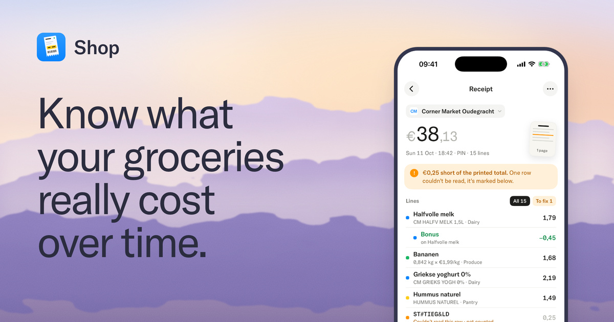
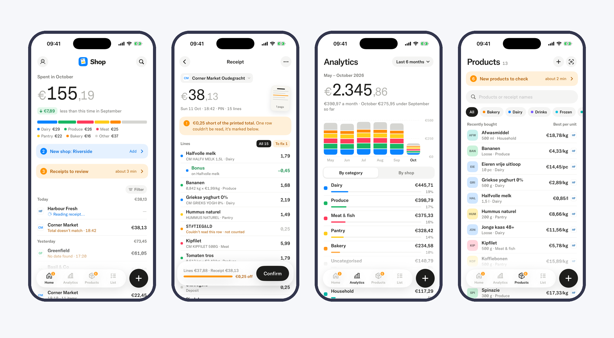

<p align="center">
  
</p>

# Shop

A self-hosted grocery receipt tracker. Photograph a receipt, and Shop reads it on your own machine and shows what you spend, which shop is cheapest, and what got more expensive.

Built for Dutch receipts (Albert Heijn, Dirk and similar). Nothing leaves your server except two optional lookups: Open Food Facts for barcodes and logo.dev for shop logos.

<picture>
  <source media="(prefers-color-scheme: dark)" srcset="docs/img/screens-dark.png">
  
</picture>

## Features

- **Receipts:** photo → local OCR → checked against the printed total. Anything that doesn't add up is flagged, never guessed.
- **Products:** lines are matched to products and prices are tracked per kg, litre or piece.
- **Analytics:** spend by month, shop, category and product, plus price changes.
- **Shopping list** that works offline, **barcode scan**, and an **MCP server** for asking an assistant about your spending.
- **Nightly backups** of the database and images.

## Quick start

Needs Docker with about 4 GB of memory to spare.

```bash
make setup     # build, start, and print the app pairing password once
```

The first build downloads the OCR models and takes several minutes. Then pair the iPhone app with your server URL and the printed password. The server speaks plain HTTP, so keep it on your LAN or behind a VPN such as Tailscale.

## Repo

| Path | What |
|---|---|
| `api/` | Go server: REST API, MCP, job queue |
| `ocr/` | OCR service (PaddleOCR) |
| `ios/` | iPhone app (SwiftUI) |
| `deploy/` | Docker Compose stack |
| `site/` | The website and guide |

## Docs

[Guide](https://shop.casprine.com/guide/) · [Operations](docs/operations.md) · [Restore](docs/restore.md) · [MCP](docs/mcp.md) · [Backend status](docs/BACKEND-STATUS.md) · [iOS setup](docs/IOS-SETUP.md)

A product from [Sunday Studio](https://www.thesunday.studio/). [MIT license](LICENSE).
